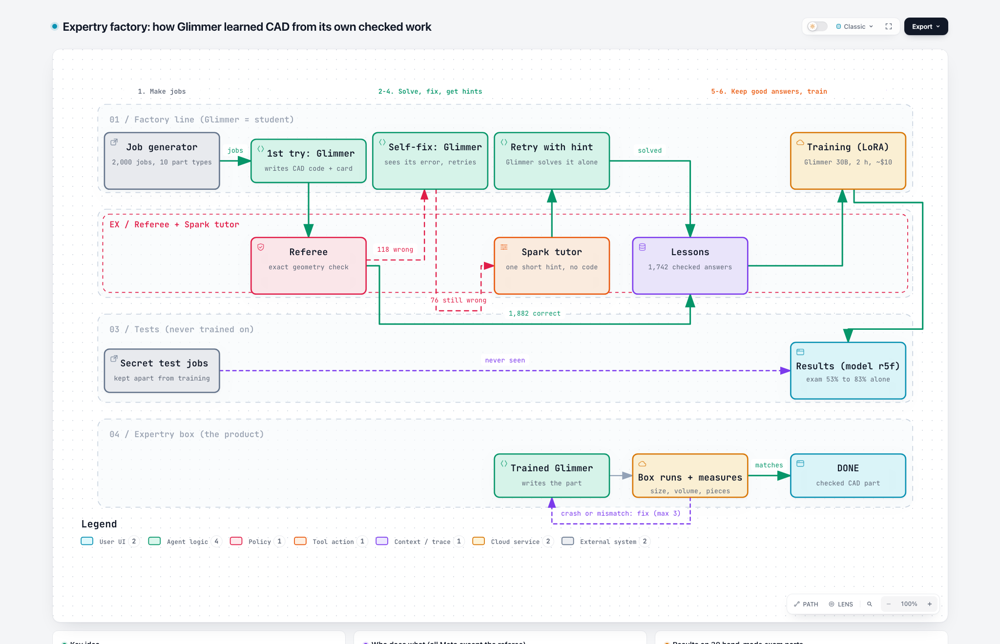

# Expertry

> **Name:** the project was first called "Forge". Internal code, cloud apps, file names, the live demo address and
> the frozen exam files keep older internal names on purpose, so nothing breaks and the exam evidence stays valid.

**Expertry turns a small open model into a private expert on your tool, learning only from answers a referee proved
correct.** Proven on CAD: Meta's open Muse Glimmer 30B went from **53% (an earlier session, one try) to 83%** on a hand-made exam with no manual, and to
**92%** with a self-check loop, about as good as the best setup (94%) that needs a 5,700-word manual, with 2.7× fewer tokens.
Built with Muse Spark Open.

**▶ Try it live: https://homegrown-factory.vercel.app** (one free live try per visitor; the
recorded demo is always there)

Meta Global AI Developer Hackathon 2026 · Indie track, Push the Frontier · build period Oct 27 - Nov 4.



Interactive diagram: [`docs/video/expertry-factory.html`](docs/video/expertry-factory.html)

## Live demo
Describe a part; the trained Glimmer (r5f, served from Modal) writes CadQuery code, a locked Modal sandbox builds it,
and the model checks its own measurements and fixes the part (up to 3 rounds, the same loop as the 92% second look).
You get a 3D view, the measurements, the code and STEP/STL files.
- **The badge is a self-check, not the exam referee:** a visitor's part has no reference answer, so "Self-check PASS"
  means it built as one solid and its overall size matches the numbers you typed (±0.5%). Otherwise it says "Built
  (size not checked)" or "Checks failed".
- **Limits:** $15 total for the whole demo, one free live try per visitor, 600 characters per job. When the money is
  used up the page pauses and plays a recorded real run. A cold model takes several minutes to wake up (14 min on the
  first start), so the page plays the recorded run meanwhile.
- **First real live run (2026-11-02):** L-bracket 80 × 30 × 45 mm with two 6 mm holes → Self-check PASS in 120 s,
  volume 27,717 mm³ (exactly base + wall − holes). It is the page's recorded run (`app/web/recorded_run.json`).
- Hosting: the page is on Vercel (`homegrown-factory.vercel.app`) and calls the Modal backend directly from the
  visitor's browser (CORS), so the one-try limit sees each visitor's own address.
- Code: page `app/web/`, backend `app/backend/`, Modal app `deploy/modal_web.py`, 106 tests in `app/tests/`. Specs:
  `specs/MUSE_PRODUCT_*.md`. Steps: `docs/product/DEPLOY.md`.

## The problem
Companies want AI that is good at their own tools, but big models are expensive, private designs often may not leave
the company, and the usual fix is a long manual pasted into every prompt. Can a small open model learn the skill itself?

## How the Expertry factory works
1. **Job generator** (built by Muse Code): 2,000 practice CAD jobs in 10 part families, each with a hidden correct part.
   100 more jobs are locked away as a secret test.
2. **First try:** Glimmer (with a one-page rule card) writes CadQuery code. A locked cloud box runs it, and a strict
   **referee** compares the part with the correct one (0.2% volume tolerance). 1,882 right, 118 wrong.
3. **Self-fix:** Glimmer sees only its own error or its own part's measurements (never the answer). 42 fixed.
4. **Spark tutor:** Muse Spark Open gives one short hint, no code, on the 76 still-unsolved jobs. With the hint,
   Glimmer solved 52 of 54.
5. **Lessons:** only referee-approved answers, with Glimmer's own reasoning, become lessons (1,742). A guard confirmed
   no lesson touches the exam. **Wrong answers never teach.**
6. **Training:** LoRA on Glimmer 30B (Modal H200, ~2 h, ~$10). The trained model needs no manual and no card.
7. **The Expertry box (the product):** the trained Glimmer writes the part, the box builds and measures it, and
   Glimmer fixes crashes or mismatches itself (up to 3 rounds) before delivering a checked part.

## The Expertry agent (self-check loop)
The Expertry box is an agent: the trained Glimmer acts, observes the real result with a tool, and decides what to do
next, without ever seeing the correct answer.
```
describe a part
   ↓
Glimmer writes CadQuery code
   ↓
TOOL: locked cloud box runs the code and measures the part (size, volume, number of solids)
   ├─ crash      → Glimmer reads the error and rewrites the code
   ├─ built      → Glimmer compares the measurements with every number in the request
   │                ├─ matches  → "DONE"
   │                └─ mismatch → Glimmer rewrites the code
   └─ at most 3 rounds; the last part that built is delivered (and, in the exam, graded)
```
- Reference-free: the agent only sees its own error messages and its own part's measurements, so it works on real
  requests where nobody knows the answer.
- Measured: on the exam the loop rescued 12 answers (4 after crashes, 8 after a measurement mismatch) and lifted the
  trained model from 83.3% to 92.2% (labelled second look). Mean 2.16 rounds per part.
- Code: `do_bx_cloud_call` with `--bx-loop` in [`experiments/final/runner_final.py`](experiments/final/runner_final.py).

## Results (rules written down before every test; the exam ran once, plus one labelled second look)
**Exam: 30 hand-made CAD parts** (15 medium, 15 hard), written before any training and never used to build anything;
3 tries each, scored at 0.2%. Plan: [`experiments/final/PLAN.md`](experiments/final/PLAN.md); freeze:
[`results/exam-2026-11-02/FREEZE.txt`](results/exam-2026-11-02/FREEZE.txt).

| Setup | Score | Hard | Tokens per correct part |
|---|---|---|---|
| Plain Glimmer, short prompt (Oct 28, 1 try, earlier session) | 53% | | |
| **Expertry Glimmer, one try (official exam)** | **83.3%** | 73% | 3,352 |
| Plain Glimmer + rule card | 85.6% | 84% | 4,145 |
| Plain Glimmer + 5,700-word manual, one try (B2) | 87.8% | 76% | 10,662 |
| **Expertry Glimmer + self-check loop (second look)** | **92.2%** | 91% | 7,946 |
| Plain Glimmer + manual + the same loop (best setup, BX) | 94.4% | 91% | 21,823 |

- Expertry + loop vs best setup: **−2.2 points, 95% CI [−11.1, +5.6]**: about as good (pre-registered bar), with no
  manual and 2.7× fewer tokens; not faster per answer (266 s vs 301 s).
- Expertry one try vs rule card: −2.2 [−12.2, +6.7], a tie. The loop added +8.9 [+1.1, +18.9] points (the loop also
  uses "xhigh" reasoning, so both changes are counted together).
- **What did not hold:** the original pre-registered claim ("as good as the best setup on one try" and "clearly beats the
  manual") **failed**: −11.1 [−24.4, +1.1] and −4.4 [−21.1, +11.1]. The cost bars passed on the token form only.
  The 92% is a labelled second look at the same exam, run once with rules written first.
- Secret practice-style test (100 jobs from the generator, never trained on): plain 62, plain + card 96, Expertry 96.
  The hand-made exam is the harder and more reliable test.

Readings: [`results/exam-2026-11-02/`](results/exam-2026-11-02/) (`compare_bars.json`, `compare_ft_acard.json`) and
[`results/exam2-ftx-2026-11-02/compare_ftx.json`](results/exam2-ftx-2026-11-02/compare_ftx.json). Every claim with its
source: [`forge-wiki/wiki/status.md`](forge-wiki/wiki/status.md).

## What we learned (each from a measured failure)
- Training on a bigger model's answers made Glimmer worse (38%, then 48% vs 52% untrained). Training on its **own**
  referee-checked answers worked (62 → 96 on the secret practice test).
- The referee is everything: the model learns exactly what the referee approves.
- A self-check loop (run, measure, fix) adds about 9 points on hard parts: crashes and two-piece parts get fixed.
- A test made by the same generator as the lessons is too easy (96%); the hand-made exam (83%) is the number to trust.

## For other tools
Only three pieces change per tool: a **job generator**, a **sandbox** to run answers, and a **referee** that decides
right or wrong automatically. The rest (Glimmer, Spark tutor, self-fix, lessons, training, the box loop) stays the
same. Best exam for a company: 30-100 of its own past jobs with known correct results, never shown to the factory.
Status: proven on CAD only.

## Before Expertry: HerdShot (Oct 26 - 28)
The first two days went to an earlier idea, **HerdShot**: stop false facts from spreading inside teams of AI agents.
Its code lives in a separate private repository (first commit Oct 26, 19:19 CET = 14:19 ET, after the 12:00 ET kickoff); copies of its reports are in
[`docs/herdshot/`](docs/herdshot/).
| Date | What was built | Result |
|---|---|---|
| Oct 26 (after the kickoff) | Harness: seeded agent-team worlds, private ballots, cost limiter, verifier and "antibody" defences, Glimmer-on-Modal deploy, live replay viewer (built by a Claude Code swarm) | built and tested offline |
| Oct 27 | **Test A** on Muse Spark 1.3: 70 team runs, 5 kinds of lies ([`testA.md`](docs/herdshot/testA.md)) | 0% of the other agents privately believed the lie in every family (needed ≥ 40% in 3 of 5) → **NO-GO** |
| Oct 27 | **A2** groupthink test, 4 roles with a stale document ([`a2.md`](docs/herdshot/a2.md)) | 12.5% believed the stale value, also with 2 agents pushing it → groupthink **not shown** |
| Oct 27 | **C1** two agents editing the same file in parallel, Haiku / Sonnet / Opus ([`c1.md`](docs/herdshot/c1.md)) | together 4-8/16 vs alone 13-16/16, but every failure was visible (git conflicts or failing tests) → no hidden problem to solve |
| Oct 27 | **C2** a lead agent writes a shared plan first ([`c2.md`](docs/herdshot/c2.md)) | 7/16 vs 4/16, below the pre-set bar of 12 |
| Oct 28 | Direction research (new ideas scored; Expertry, then called Forge, ranked first) | HerdShot paused; Expertry started at 12:45 |

**Conclusion** ([`2026-10-27-day-conclusion.md`](docs/herdshot/2026-10-27-day-conclusion.md)): today's agents read the
project files and reject false facts, and a simple verifier agent already solves what HerdShot set out to do. Rather
than build a product for a problem our own tests could not show, we stopped and chose a direction with measurable room
to improve. The same habits carried over: rules written before each test, money caps, and a verifier before every
paid step.

## Where Modal, Baseten and Meta were used
All cloud work ran on hackathon credits; every paid script has a money cap.
| Service | What ran there | When |
|---|---|---|
| **Modal** (GPU + CPU sandboxes) | Glimmer 30B served with vLLM (A100-80GB) for every Glimmer answer: Keel test, first CAD test, baselines, the 2,000-job factory first try, self-fix, hinted retries, dev tests, the exam and the second look | Oct 28 - Nov 2 |
| **Modal** | The locked CadQuery box and the referee (CPU sandboxes, no network) that build and grade every answer | Oct 30 - Nov 2 |
| **Modal** | Training: smoke test and first round on H100; rounds R3, R5 and the final r5f on H200; LoRA merges; model files on Modal volumes | Oct 29 - Nov 1 |
| **Baseten** (Muse Spark Open) | HerdShot backend added (no spend) | Oct 27 |
| **Baseten** | First CAD test, Spark arm (30/30) | Oct 28 |
| **Baseten** | Factory teacher answers: pilot $0.52, main run $4.38, R3 run $4.98 (those answers trained R1/R3, which did not help) | Oct 30 |
| **Baseten** | Spark tutor hints on the 76 unsolved jobs ($3.05) | Nov 1 |
| **Meta API** (Muse Spark 1.3) | HerdShot test A, 70 agent-team runs ($22.92) | Oct 27 |
| **Meta API** (Muse Code) | Every build round of the factory, runners, training pipeline, second-look arm, and the GitHub pushes | Oct 28 - Nov 2 |

Money: about $72 of Modal credit and about $13 of Baseten credit over the whole Expertry project, plus Muse Code on
Meta credit (each round's cost is in its log in `results/`).

## Built during the hackathon
Everything here was made during the hackathon; the first commit is Oct 28. `deploy/modal_glimmer.py` was adapted from
our earlier hackathon project HerdShot (written Oct 26, after the 12:00 ET kickoff).
| Date | What was built |
|---|---|
| Oct 28 | Setup; Glimmer on Modal; a fictional company tool "Keel" (Glimmer already 97.8%, dropped); the 30-part CAD exam |
| Oct 29 | Baselines on the exam; training smoke test |
| Oct 30 | The factory (Muse Code, 4 rounds); first training rounds (answer-only: 38%; Spark reasoning: 48%) |
| Oct 31 | R5 plan: train on Glimmer's own checked answers; rule card v2; 2,000-job first try |
| Nov 1 | Self-fix, training r5 (dev 94/100), Spark hints (52/54), final training r5f |
| Nov 2 | Dev 96/100; one-shot exam (83.3%); second look with the loop (92.2%); renamed |

The full day-by-day log is in [`forge-wiki/log.md`](forge-wiki/log.md).

Note on the git history: early market notes (Oct 28) listed defence and medical companies as example customers. We
removed them on Oct 30 to follow the hackathon rules; the project was never built for those uses. The history is kept
as proof of when each part was built.

## Models and licences
| Model | Role | Licence / terms |
|---|---|---|
| Muse Glimmer 30B (`meta-models/Muse-Glimmer-30B`) | the student; trained with LoRA, served with vLLM on Modal | [Apache-2.0](https://huggingface.co/meta-models/Muse-Glimmer-30B) |
| Muse Spark Open (`meta-models/Muse-Spark-Open-816B-A42B`, via Baseten) | the tutor: short hints (no code) on the jobs Glimmer could not solve; earlier rounds also used its answers | [Muse Model License](https://huggingface.co/meta-models/Muse-Spark-Open-816B-A42B/blob/main/LICENSE.md): allows training other models on its outputs ("Derivatives"); requires "Built with Muse Spark Open" |
| Muse Spark 1.3 (api.meta.ai) | Muse Code, the coding agent that wrote the code | Meta API terms |
| Muse Wonder (api.meta.ai) | optional backup teacher (`--escalate`); **never used for training data** | [Meta Model API Terms](https://dev.meta.ai/legal/terms-of-service) §10.1 forbid training competing models on outputs without Meta's written authorization, so Wonder outputs stay out of training |

## Who wrote what
- **Product code** (factory, teacher runner, learning loop, gallery, cloud box and referee, runners, training pipeline,
  the Keel company tool and dashboard, their tests): written by **Muse Code** (Meta's coding agent) from written specs.
  Each build round's full event log and a readable diary are in [`results/`](results/) (`muse-*.jsonl`; diaries
  `muse-final-r1*.diary.md` for the factory rounds): every file Muse read, edited and ran. Muse Code cannot commit, so
  its work was committed by Alyssa.
- **Written by Claude (Anthropic), on purpose:** specs and plans (`*SPEC*.md`, `PLAN.md`), the wiki, and **all exam
  content and referees**, so the AI being tested never writes its own test:
  `experiments/first-test/` (`jobs.py`, `checks.py`, `expected.json`, `selftest.py`, `blind/`, `run_live.sh`),
  `experiments/keel-exam/` and `keel-exam-v2/` (`jobs.py`, `referee.py`, `selftest.py`, `score_blind.py`, `blind/`),
  `experiments/thinking/` (`thinking_jobs.py`, `selftest.py`, `hand/`), `experiments/option-a/` drafts,
  `experiments/bmax/examples.py`, `scripts/`, and the blind-rebuild answers in `results/blind-rebuild*`.
- **Also written by Claude (disclosed):** `deploy/modal_glimmer.py` (adapted from HerdShot, later edited by Muse Code),
  and a few early run scripts (`experiments/smoke/train_smoke.py`, `score_answer.py`,
  `experiments/bmax/run_session*.sh`, `glimmer_dashboard.py`, `experiments/option-a/audit/coverage_audit.py`). They
  are records of runs that already happened; Muse Code rebuilt the parts still in use.
- **Small fixes by Claude (disclosed, user decision 2026-10-30):** `experiments/final/runner_final.py` `ft_messages`
  (optional rule card in the system message via FORGE_RULE_CARD); `experiments/final/RULE_CARD.md` (content).
  2026-10-31 (verifier B3b/B6b): `cloud_cq.build_sandbox(lifetime_s=…)` + its use in `make_jobs.py` (the reused batch
  box lives up to 3 h instead of 90 s), and `forge_train.check_rule_card` strips the card like `ft_messages`; 2 tests. Also `experiments/final/run_base_session.sh`: a `.jsonl`
  jobs-file spec and a `WORKERS` env (default 8) for the R5 runs. `runner_final.load_factory_jobs_file` keeps each job's
  reference for grading only (verifier B7). `experiments/final/RULE_CARD.md` v2 (two lines added after the R5 pilot's
  crashes, user decision B; v1 kept as RULE_CARD_V1.md) and its sha256 constant in `forge_train.py`. `experiments/viewer/make_viewer.py` default_render_fn
  (drives one cloud sandbox from the Mac instead of calling the Modal Function directly). `run_base_session.sh` RUNNER_EXTRA env
  (extra runner args for the R5 self-fix step). The same `.jsonl` spec, WORKERS and RUNNER_EXTRA in
  `run_final_session.sh` (R5 dev step). `experiments/r5/compare_dev.py` (dev reading: reuses compare.py's paired
  bootstrap; reads results only).
- **Small fixes by Claude on Nov 1-2 (disclosed):** `experiments/r5/hints.py` (max_tokens 16,000, finish_reason stored,
  word-match code filter; verifier S1-S3); `experiments/r5/build_mix.py --keep-hint` (tutoring rows; user decision);
  `experiments/r5/RULE_CARD_V3_RETRY.md` (one card line, hinted retries only); `experiments/final/compare_ft_acard.py`
  and `experiments/final/compare_ftx.py` (pre-registered readings, reuse compare.py); data prep of
  `results/r5-hints-2026-11-01/hint_input.jsonl`. **Muse Code** built the FTX second-look arm (`--bx-loop`) from
  `specs/MUSE_FTX_2026-11-02.md` and pushed the repo to GitHub.
- **The live demo (Nov 2):** page, backend and Modal web app written by **Muse Code** in 4 rounds from
  `specs/MUSE_PRODUCT_2026-11-02.md` (logs `results/muse-product-p*.jsonl`); the page design (mockup in
  `docs/product/mockup/`) by Claude with Alyssa. **Small fixes by Claude (disclosed):** `app/backend/loop.py` (after a
  build the model sees its own measurements and may fix, the FTX rule; + 2 tests); `deploy/modal_web.py` (static page
  mounted after the API routes; deploy settings baked into the image; FORGE_URL startup check); phone CSS in
  `app/web/styles.css`; wording ("strict" removed), footer links and the real recorded run in `app/web/`;
  `app/web/dev_server.py` fake counters (local preview only, not deployed).
- **Review:** a separate Claude verifier agent reviewed every step before money was spent.
- **Published by Alyssa** (all commits are hers; most carry a "Co-Authored-By: Claude" line).

## Run it
Needs macOS or Linux, Python 3.12, and for cloud steps a Modal account (and Baseten for the teacher).
```bash
git clone https://github.com/alyssaaa11/expertery.git expertry && cd expertry
python3.12 -m venv .venv && .venv/bin/pip install cadquery==2.8.0 cadquery-ocp==7.9.3.1 modal==1.6.3 pytest
.venv/bin/python -I scripts/check_cadquery.py          # expect: size mm 20.0 20.0 20.0, volume 7607.3
.venv/bin/python -m pytest -q experiments/final experiments/factory experiments/freecad experiments/train experiments/common
.venv/bin/python experiments/factory/make_jobs.py      # 200 jobs + the self-check table, offline
.venv/bin/python experiments/factory/gallery.py --out results/factory-gallery   # pictures of 10 parts
```
Cloud steps (cost money, need `modal setup` and your own keys in environment variables `BASETEN_KEY`,
`META_HERDSHOT_API_KEY`, `GLIMMER_URL`/`GLIMMER_KEY`; our `*_session.sh` wrappers read them from envsave): `experiments/final/cloud_cq.py --check-refs --exam factory`
(Modal CPU, cents), `experiments/factory/teacher.py --ids pilot --out <dir> --budget-dollars 1.2` (Baseten).
Every paid script refuses to run past its money cap.

## Folders
| Folder | What is in it |
|---|---|
| `experiments/factory/` | the factory: job generator, cloud runner, learning loop (`patterns.py`), gallery |
| `experiments/r5/` | the final factory round: 2,000 practice jobs, self-fix, Spark hints, lesson mix, PLAN |
| `experiments/final/` | cloud box + referee (`cloud_cq.py`), the final plan and Muse specs |
| `experiments/first-test/` | the frozen 30-job exam and its referee (`checks.py`) |
| `experiments/bmax/`, `b2-hint/`, `freecad/`, `thinking/`, `keel-exam-v2/` | earlier tests, each with its frozen PLAN |
| `experiments/train/` | training pipeline (LoRA on Modal) with exam guard and money cap |
| `deploy/` | Glimmer on Modal |
| `company/` | the fictional company tool Keel (earlier direction) |
| `results/` | run results, Muse Code logs and diaries |
| `forge-wiki/` | the project's knowledge base (Obsidian vault): status, findings, decisions, lessons |
| `docs/diagrams/`, `docs/video/` | diagrams (open the `.html` files in a browser), the factory diagram |

Training rule: never `modal run forge_train.py::train` directly; it bypasses the exam guard and the money cap.

## Licence
This repository's own code and docs: Apache-2.0, see [LICENSE](LICENSE).

**Trained models:** a Glimmer trained on Spark Open's answers is a "Derivative" under the Muse Model License. Any
trained weights or LoRA we share will ship with the Muse Spark Open LICENSE and Usage Policy, Glimmer's Apache-2.0
licence and Usage Policy, and the notice "Built with Muse Spark Open". No weights are in this repository.

**Third-party documentation included:**
- `experiments/first-test/manual.md` (and the copies used as prompts): excerpts of the CadQuery 2.8 documentation,
  Apache-2.0 (https://github.com/CadQuery/cadquery).
- `experiments/freecad/manual.md`: excerpts of the FreeCAD documentation (FreeCAD wiki), CC-BY-3.0
  (https://wiki.freecad.org), attributed to the FreeCAD documentation authors.
