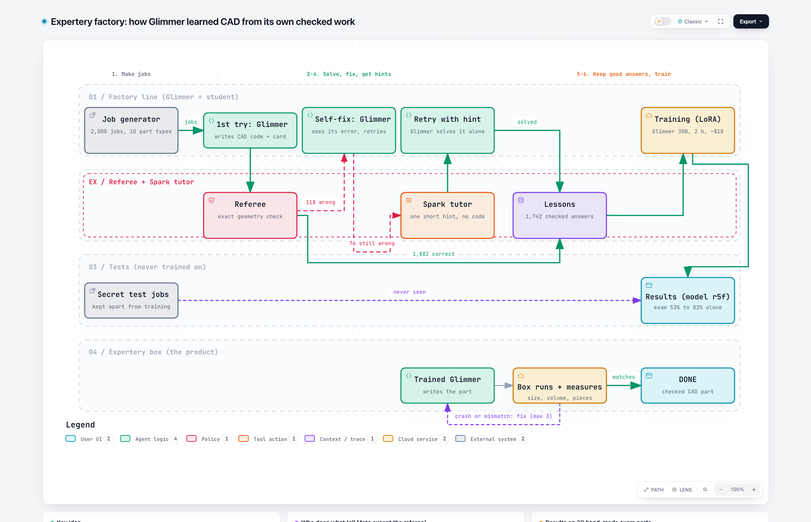

# Expertery

> **Name:** the project was first called "Forge", then "Homegrown" (Nov 2-3), now Expertery. Internal code, cloud apps, file names and the frozen
> exam files keep older internal names on purpose, so nothing breaks and the exam evidence stays valid.

**Expertery turns a small open model into a private expert on your tool, learning only from answers a referee proved
correct.** Proven on CAD: on a hand-made 30-part exam it never saw, the trained Muse Glimmer 30B scored **83%** in one
try with no manual (official exam), and **92% with its self-check loop** (a labelled second look), about as good as the
best setup (94%), which needs a 3,240-word (≈ 5,700-token) manual in every prompt, with 2.7× fewer tokens.
For scale: plain Glimmer with a short prompt scored 53% on the same 30 parts (Oct 28, one try per part).
Built with Muse Spark Open.

**▶ Try it live: https://expertery.com** (one free live try per visitor; the
recorded demo is always there)

Meta Global AI Developer Hackathon 2026 · Indie track, Push the Frontier · build period Oct 27 - Nov 4.



Interactive diagram: [`docs/video/expertery-factory.html`](docs/video/expertery-factory.html)

## Live demo
Describe a part; the trained Glimmer (r5f, served from Modal) writes CadQuery code, a locked Modal sandbox builds it,
and the model checks its own measurements and fixes the part (up to 3 rounds, the same loop as the 92% second look).
You get a 3D view, the measurements, the code and STEP/STL files.
- **The badge is a self-check, not the exam referee:** a visitor's part has no reference answer, so "Self-check PASS"
  means it built as one solid and its overall size matches the numbers you typed (±0.5%). Otherwise it says "Built
  (size not checked)" or "Checks failed".
- **Limits:** $20 total for the whole demo, one free live try per visitor, 600 characters per job. When the money is
  used up the page pauses and plays a recorded real run. A cold model takes several minutes to wake up (14 min on the
  first start), so the page plays the recorded run meanwhile.
- **First real live run (2026-11-02):** L-bracket 80 × 30 × 45 mm with two 6 mm holes → Self-check PASS in 120 s,
  volume 27,717 mm³ (exactly base + wall − holes). It is the page's recorded run (`app/web/recorded_run.json`).
- Hosting: the page is on Vercel (`expertery.com`; the old `expertery.vercel.app` address still works) and calls the Modal backend directly from the
  visitor's browser (CORS), so the one-try limit sees each visitor's own address.
- Code: page `app/web/`, backend `app/backend/`, Modal app `deploy/modal_web.py`, 109 tests in `app/tests/`. Specs:
  `specs/MUSE_PRODUCT_*.md`. Steps: `docs/product/DEPLOY.md`.

## The problem
Companies want AI that is good at their own tools, but big models are expensive, private designs often may not leave
the company, and the usual fix is a long manual pasted into every prompt. Can a small open model learn the skill itself?

## How the Expertery factory works
1. **Job generator** (built by Muse Code): 2,000 practice CAD jobs in 10 part families, each with a hidden correct part.
   100 more jobs are locked away as a secret test.
2. **First try:** Glimmer (with a one-page rule card) writes CadQuery code. A locked cloud box runs it, and a strict
   **referee** compares the part with the correct one (0.2% volume tolerance). 1,882 right, 118 wrong.
3. **Self-fix:** Glimmer sees only its own error or its own part's measurements (never the answer). 42 fixed.
4. **Spark tutor:** Muse Spark Open gives one short hint, no code, on the 76 still-unsolved jobs (54 hints were
   usable; 22 were cut off at the length limit). With the hint, Glimmer solved 52 of the 54.
5. **Lessons:** only referee-approved answers, with Glimmer's own reasoning, become lessons. Answers that quote the rule
   card were dropped (228), because the trained model never sees the card: 1,742 lessons. A guard confirmed no lesson
   touches the exam. **Wrong answers never teach.**
6. **Training:** LoRA on Glimmer 30B (Modal H200, 431 steps, 1 h 57 min). 20 lessons longer than the training length
   limit were skipped, so 1,722 lessons were trained. The trained model needs no manual and no card.
7. **The Expertery box (the product):** the trained Glimmer writes the part, the box builds and measures it, and
   Glimmer fixes crashes or mismatches itself (up to 3 rounds) before delivering a checked part.

## The Expertery agent (self-check loop)
The Expertery box is an agent: the trained Glimmer acts, observes the real result with a tool, and decides what to do
next, without ever seeing the correct answer.
```
describe a part
   ↓
Glimmer writes CadQuery code
   ↓
TOOL: locked cloud box runs the code and measures the part (size, volume, number of solids)
   ├─ crash      → Glimmer reads the error and rewrites the code
   ├─ built      → Glimmer compares the measurements with every number in the request
   │                ├─ matches  → "DONE"
   │                └─ mismatch → Glimmer rewrites the code
   └─ at most 3 rounds; the last part that built is delivered (and, in the exam, graded)
```
- Reference-free: the agent only sees its own error messages and its own part's measurements, so it works on real
  requests where nobody knows the answer.
- Measured: on the exam the loop rescued 12 answers (4 after crashes, 8 after a measurement mismatch) and lifted the
  trained model from 83.3% to 92.2% (labelled second look). Mean 2.16 rounds per part.
- Code: `do_bx_cloud_call` with `--bx-loop` in [`experiments/final/runner_final.py`](experiments/final/runner_final.py).

## Install Expertery (v0)
Expertery v0 is a command-line product a company installs into its **own** Modal account, so its past work, exams and
trained model stay there. One tool supported so far: CadQuery CAD. Built by Muse Code (Nov 3); details in
[`docs/INSTALL.md`](docs/INSTALL.md).
```bash
sh install.sh            # needs Python 3.12, uv and modal (run `modal setup` first)
expertery init           # checks the Modal login, finds or creates the locked CAD box, writes ~/.expertery/config.json
expertery exam build examples/past-work-brackets --out my-exam --cap-dollars 2.5   # past jobs → a checked exam
expertery exam review my-exam && expertery exam lock my-exam   # a person decides every flag, then the exam is locked
expertery test --exam my-exam --model trained --name brackets --out my-test --cap-dollars 3 --loop
expertery status         # config, Modal apps, latest exam folders
```
`expertery train` and `expertery serve` wrap the factory's training and serving steps. `exam build`, `test` and
`train` refuse to run without a `--cap-dollars` money cap, and most commands have `--dry-run`. Run for real so far:
`init` and `exam build` (below); the other commands are covered by tests only (39 tests).
- **Exam agent:** for each past job (request + finished part), Muse Spark Open reads only the request and builds the
  part; the referee compares it with the real part. If most tries fail, an explainer decides whether the request's
  wording is unclear (flagged, with a suggested sentence) or the reader made a mistake. A person decides every flag.
- **First real run** on 20 example bracket jobs ([`report.md`](results/expertery-exam-brackets-2026-11-03c/report.md)):
  18 ready, 2 flagged (B7, B8: which side of Y = 0 the plate thickness goes), est. $1.72 of a $2.50 cap. Results vary
  between runs because the readers sample at temperature 1.0.
- Not built yet: making practice jobs from a company's past work (v0 uses the factory's job generator).

## Results (rules written down before every test; the exam ran once, plus one labelled second look)
**Exam: 30 hand-made CAD parts** (15 medium, 15 hard), written before any training and never used to build anything;
3 tries each, scored at 0.2%. Plan: [`experiments/final/PLAN.md`](experiments/final/PLAN.md); freeze:
[`results/exam-2026-11-02/FREEZE.txt`](results/exam-2026-11-02/FREEZE.txt).

| Setup | Score | Hard | Tokens per correct part |
|---|---|---|---|
| Plain Glimmer, short prompt (Oct 28, 1 try, earlier session) | 53% | | |
| **Expertery Glimmer, one try (official exam)** | **83.3%** | 73% | 3,352 |
| Plain Glimmer + rule card | 85.6% | 84% | 4,145 |
| Plain Glimmer + 3,240-word manual, one try (B2) | 87.8% | 76% | 10,662 |
| **Expertery Glimmer + self-check loop (second look)** | **92.2%** | 91% | 7,946 |
| Plain Glimmer + manual + the same loop (best setup, BX) | 94.4% | 91% | 21,823 |

- Expertery + loop vs best setup: **−2.2 points, 95% CI [−11.1, +5.6]**: about as good (pre-registered bar), with no
  manual and 2.7× fewer tokens; not faster per answer (266 s vs 301 s).
- Expertery one try vs rule card: −2.2 [−12.2, +6.7], a tie. The loop added +8.9 [+1.1, +18.9] points (the loop also
  uses "xhigh" reasoning, so both changes are counted together).
- **What did not hold:** the original pre-registered claim ("as good as the best setup on one try" and "clearly beats the
  manual") **failed**: −11.1 [−24.4, +1.1] and −4.4 [−21.1, +11.1]. The cost bars passed on the token form only.
  The 92% is a labelled second look at the same exam, run once with rules written first.
- Secret practice-style test (100 jobs from the generator, never trained on): plain 62, plain + card 96, Expertery 96.
  The hand-made exam is the harder and more reliable test.

Readings: [`results/exam-2026-11-02/`](results/exam-2026-11-02/) (`compare_bars.json`, `compare_ft_acard.json`) and
[`results/exam2-ftx-2026-11-02/compare_ftx.json`](results/exam2-ftx-2026-11-02/compare_ftx.json). Every claim with its
source: [`forge-wiki/wiki/status.md`](forge-wiki/wiki/status.md).

## What we learned (each from a measured failure)
- **Study the student before teaching it.** We first ran the untrained Glimmer to see where it fails: in the first
  practice run 28 of its 47 crashes came from one CadQuery call that does not exist, so two lines added to its rule
  card took it from 74.5% to 94% on the same 200 practice jobs. After that, every lesson started from Glimmer's own
  work: its own checked answers and reasoning, self-fix from its own errors, and Spark hints only on the jobs it could
  not solve. The training fits how Glimmer works instead of a generic dataset; lessons written in a bigger model's
  style made it worse (next point).
- Training on a bigger model's answers made Glimmer worse (38%, then 48% vs 52% untrained). Training on its **own**
  referee-checked answers worked (62 → 96 on the secret practice test).
- The referee is everything: the model learns exactly what the referee approves.
- A self-check loop (run, measure, fix) adds about 9 points on hard parts: crashes and two-piece parts get fixed.
- A test made by the same generator as the lessons is too easy (96%); the hand-made exam (83%) is the number to trust.

## For other tools
Only three pieces change per tool: a **job generator**, a **sandbox** to run answers, and a **referee** that decides
right or wrong automatically. The rest (Glimmer, Spark tutor, self-fix, lessons, training, the box loop) stays the
same. Best exam for a company: 30-100 of its own past jobs with known correct results, never shown to the factory.
Status: proven on CAD only.

## Next (not built yet)
- **Any tool with a checkable answer:** PLC code for factory machines, chip design, SQL. Each needs only a job
  generator, a sandbox and a referee; everything else stays the same.
- **Practice jobs made from a company's own past work** (v0 uses the factory's job generator).
- **Updates that prove themselves:** when the factory improves, `expertery update` would retrain the company's model in
  its own cloud and switch only if the new model beats the old one on the company's locked exam. Today an update is
  `git pull` + `sh install.sh`, and nothing tells a company a new version exists.

## Before Expertery: HerdShot (Oct 26 - 28)
The first two days went to an earlier idea, **HerdShot**: stop false facts from spreading inside teams of AI agents.
Our own pre-registered tests showed today's agents already read the project files and reject false facts, so there was
no problem left to solve; we stopped on Oct 28 and started Expertery (then called Forge). Its code lives in a separate
private repository (first commit Oct 26, 19:19 CET = 14:19 ET, after the 12:00 ET kickoff); its reports and the day's
conclusion are in [`docs/herdshot/`](docs/herdshot/). Only one file came over: `deploy/modal_glimmer.py`.

## Where Modal, Baseten and Meta were used
All cloud work ran on hackathon credits; every paid script has a money cap.
| Service | What ran there | When |
|---|---|---|
| **Modal** (GPU + CPU sandboxes) | Glimmer 30B served with vLLM (A100-80GB) for every Glimmer answer: Keel test, first CAD test, baselines, the 2,000-job factory first try, self-fix, hinted retries, dev tests, the exam, the second look and the live demo | Oct 28 - Nov 4 |
| **Modal** | The locked CadQuery box and the referee (CPU sandboxes, no network) that build and grade every answer | Oct 30 - Nov 4 |
| **Modal** | Training: smoke test and first round on H100; rounds R3, R5 and the final r5f on H200; LoRA merges; model files on Modal volumes | Oct 29 - Nov 1 |
| **Baseten** (Muse Spark Open) | HerdShot backend added (no spend) | Oct 27 |
| **Baseten** | First CAD test, Spark arm (30/30) | Oct 28 |
| **Baseten** | Factory teacher answers: pilot $0.52, main run $4.38, R3 run $4.98 (those answers trained R1/R3, which did not help) | Oct 30 |
| **Baseten** | Spark tutor hints on the 76 unsolved jobs ($3.05) | Nov 1 |
| **Baseten** | Exam agent readers on the 20 example bracket jobs (≈ $3.3, two runs) | Nov 3 |
| **Meta API** (Muse Spark 1.3) | HerdShot test A, 70 agent-team runs ($22.92) | Oct 27 |
| **Meta API** (Muse Code) | Every build round of the factory, runners, training pipeline, second-look arm, live demo, installer, exam agent, and the GitHub pushes | Oct 28 - Nov 4 |

Money (Nov 4): about $81 of Modal credit and about $16 of Baseten credit over the whole Expertery project, plus Muse Code on
Meta credit (each round's cost is in its log in `results/`).

## Built during the hackathon
Everything here was made during the hackathon; the first commit is Oct 28. `deploy/modal_glimmer.py` was adapted from
our earlier hackathon project HerdShot (written Oct 26, after the 12:00 ET kickoff).
| Date | What was built |
|---|---|
| Oct 28 | Setup; Glimmer on Modal; a fictional company tool "Keel" (Glimmer already 97.8%, dropped); the 30-part CAD exam |
| Oct 29 | Baselines on the exam; training smoke test |
| Oct 30 | The factory (Muse Code, 4 rounds); first training rounds (answer-only: 38%; Spark reasoning: 48%) |
| Oct 31 | R5 plan: train on Glimmer's own checked answers; rule card v2; 2,000-job first try |
| Nov 1 | Self-fix, training r5 (dev 94/100), Spark hints (52/54), final training r5f |
| Nov 2 | Dev 96/100; one-shot exam (83.3%); second look with the loop (92.2%); live demo page |
| Nov 3 | Expertery v0 installer and `expertery` CLI; exam agent (Spark Open readers); name Expertery |
| Nov 4 | README and page fixes, public repository |

The full day-by-day log is in [`forge-wiki/log.md`](forge-wiki/log.md).

Note on the git history: early market notes (Oct 28) listed defence and medical companies as example customers. We
removed them on Oct 30 to follow the hackathon rules; the project was never built for those uses. The history is kept
as proof of when each part was built.

## Models and licences
| Model | Role | Licence / terms |
|---|---|---|
| Muse Glimmer 30B (`meta-models/Muse-Glimmer-30B`) | the student; trained with LoRA, served with vLLM on Modal | [Apache-2.0](https://huggingface.co/meta-models/Muse-Glimmer-30B) |
| Muse Spark Open (`meta-models/Muse-Spark-Open-816B-A42B`, via Baseten) | the tutor: short hints (no code) on the jobs Glimmer could not solve; earlier rounds also used its answers | [Muse Model License](https://huggingface.co/meta-models/Muse-Spark-Open-816B-A42B/blob/main/LICENSE.md): allows training other models on its outputs ("Derivatives"); requires "Built with Muse Spark Open" |
| Muse Spark 1.3 (api.meta.ai) | Muse Code, the coding agent that wrote the code | Meta API terms |
| Muse Wonder (api.meta.ai) | optional backup teacher (`--escalate`); **never used for training data** | [Meta Model API Terms](https://dev.meta.ai/legal/terms-of-service) §10.1 forbid training competing models on outputs without Meta's written authorization, so Wonder outputs stay out of training |

## Who wrote what
- **Muse Code** (Meta's coding agent) wrote the product code from written specs: the factory, cloud box and referee,
  runners, training pipeline, live demo page and backend, the installer and the exam agent. Every build round's full
  event log is in [`results/`](results/) (`muse-*.jsonl`).
- **Claude (Anthropic)** wrote the specs, plans and **all exam content and referees** (so the AI being tested never
  writes its own test), a few early run scripts, and small disclosed fixes. Claude is never inside the product.
- **A separate Claude verifier agent** reviewed every step before money was spent.
- **Alyssa** decided every step and published every commit (Muse Code cannot commit).
- Every file by author, with every small fix: [`docs/WHO-WROTE-WHAT.md`](docs/WHO-WROTE-WHAT.md).

## Run it
No account needed for the first five lines (offline: CAD check, tests, job generator, gallery). Needs macOS or
Linux and Python 3.12; cloud steps need a Modal account (and Baseten for the teacher). The live demo needs nothing.
```bash
git clone https://github.com/alyssaaa11/expertery.git expertery && cd expertery
python3.12 -m venv .venv && .venv/bin/pip install cadquery==2.8.0 cadquery-ocp==7.9.3.1 modal==1.6.3 pytest
.venv/bin/python -I scripts/check_cadquery.py          # expect: size mm 20.0 20.0 20.0, volume 7607.3
.venv/bin/python -m pytest -q experiments/final experiments/factory experiments/freecad experiments/train experiments/common
.venv/bin/python experiments/factory/make_jobs.py      # 200 jobs + the self-check table, offline
.venv/bin/python experiments/factory/gallery.py --out results/factory-gallery   # pictures of 10 parts
```
Cloud steps (cost money, need `modal setup` and your own keys in environment variables `BASETEN_KEY`,
`META_HERDSHOT_API_KEY`, and `GLIMMER_URL`/`GLIMMER_KEY` = the URL and key of your own Glimmer server from
`deploy/modal_glimmer.py`): `experiments/final/cloud_cq.py --check-refs --exam factory`
(Modal CPU, cents), `experiments/factory/teacher.py --ids pilot --out <dir> --budget-dollars 1.2` (Baseten).
Every paid script refuses to run past its money cap.

## Folders
| Folder | What is in it |
|---|---|
| `experiments/factory/` | the factory: job generator, cloud runner, learning loop (`patterns.py`), gallery |
| `experiments/r5/` | the final factory round: 2,000 practice jobs, self-fix, Spark hints, lesson mix, PLAN |
| `experiments/final/` | cloud box + referee (`cloud_cq.py`), the final plan and Muse specs |
| `experiments/first-test/` | the frozen 30-job exam and its referee (`checks.py`) |
| `experiments/bmax/`, `b2-hint/`, `freecad/`, `thinking/`, `keel-exam-v2/` | earlier tests, each with its frozen PLAN |
| `experiments/train/` | training pipeline (LoRA on Modal) with exam guard and money cap |
| `deploy/` | Glimmer on Modal |
| `app/` | the live demo: page (`web/`), backend, tests |
| `expertery/`, `install.sh`, `examples/` | Expertery v0: the installer, the `expertery` CLI, the exam agent, 20 example past jobs |
| `company/` | the fictional company tool Keel (earlier direction) |
| `results/` | run results, Muse Code logs and diaries |
| `forge-wiki/` | the project's knowledge base (Obsidian vault): status, findings, decisions, lessons |
| `docs/diagrams/`, `docs/video/` | diagrams (open the `.html` files in a browser), the factory diagram |

Training rule: never `modal run forge_train.py::train` directly; it bypasses the exam guard and the money cap.

## Licence
This repository's own code and docs: Apache-2.0, see [LICENSE](LICENSE).

**Trained models:** a Glimmer trained on Spark Open's answers is a "Derivative" under the Muse Model License. Any
trained weights or LoRA we share will ship with the Muse Spark Open LICENSE and Usage Policy, Glimmer's Apache-2.0
licence and Usage Policy, and the notice "Built with Muse Spark Open". No weights are in this repository.

**Third-party documentation included:**
- `experiments/first-test/manual.md` (and the copies used as prompts): excerpts of the CadQuery 2.8 documentation,
  Apache-2.0 (https://github.com/CadQuery/cadquery).
- `experiments/freecad/manual.md`: excerpts of the FreeCAD documentation (FreeCAD wiki), CC-BY-3.0
  (https://wiki.freecad.org), attributed to the FreeCAD documentation authors.
