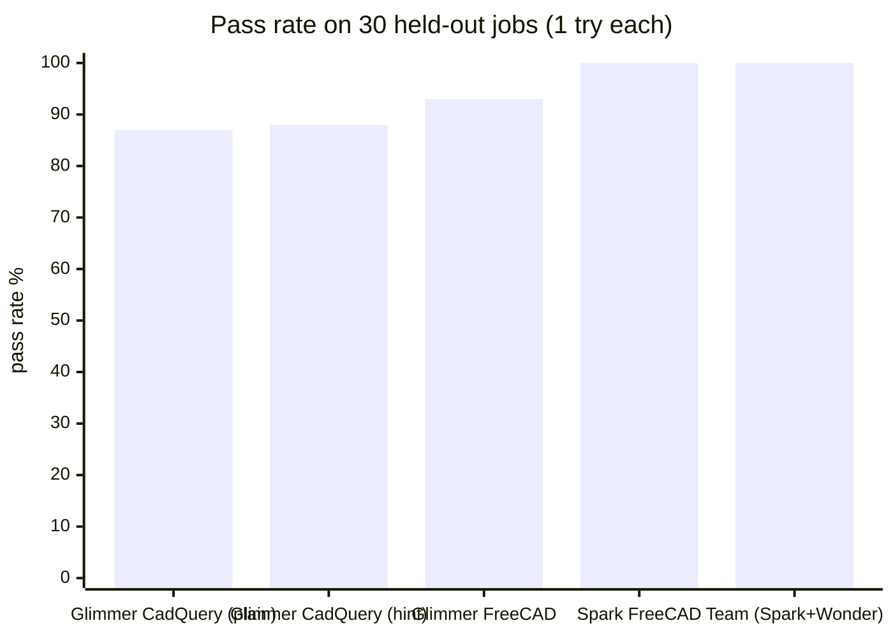
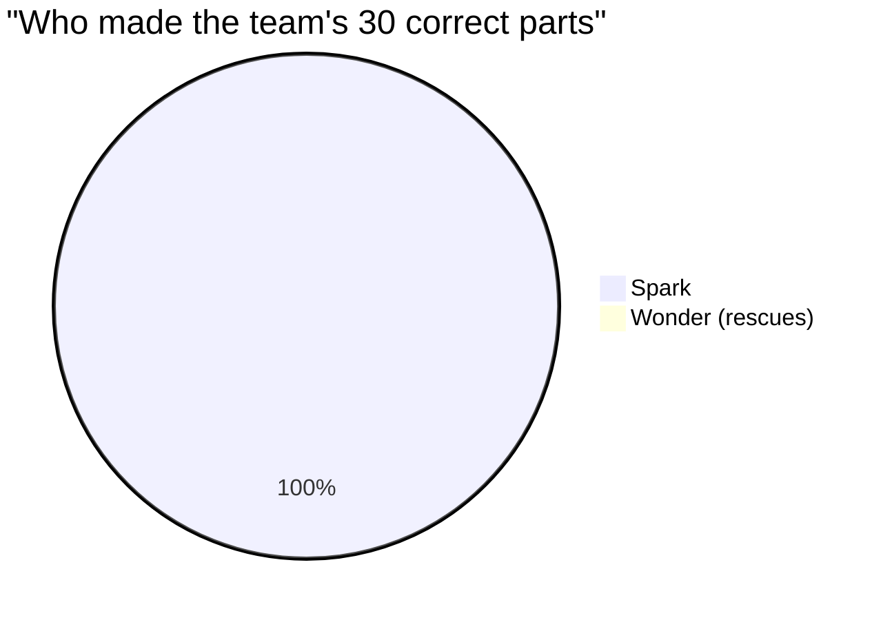

# FreeCAD gap test: Glimmer 93%, Spark 100% → stay on CadQuery (2026-10-29)

**Summary**: On the same 30 held-out jobs (15 medium + 15 hard), written in FreeCAD instead of CadQuery, Glimmer
passed **28/30 (93%)** and Spark Open **30/30 (100%)**, one try each. The pre-registered rule says **stay on hard
CadQuery jobs** (rule 3: Glimmer ≥ 75%). Wonder had nothing to rescue (Spark failed 0 jobs), so **Wonder's share = 0%**.
Both of Glimmer's misses were the same FreeCAD API mistake (`makeCylinder()` with keyword arguments).

**Sources** (verified): `results/freecad-gap-2026-10-29-run2/final/report.md` + `summary.json` (runner_fc --summarize
over main-GS + main-W), `main-GS/calls.jsonl`, `PILOT_NOTE.md`, `LAUNCH_NOTE.md`, `session.log`; plan
`experiments/freecad/PLAN.md` (rules 1-6, frozen before the run); run commands `experiments/freecad/RUN.md`.
**Live dashboard (final state)**: `forge-wiki/wiki/assets/dashboards/freecad-gap-2026-10-29.html`.

## Result

| Arm | Medium | Hard | All | Failure tags |
|---|---|---|---|---|
| Glimmer, FreeCAD (G) | 14/15 | 14/15 | **28/30 = 93%** | 2 api_error, 0 wrong_geometry, 0 harness |
| Spark Open, FreeCAD (S) | 15/15 | 15/15 | **30/30 = 100%** | – |
| Team T = S ∪ Wonder rescues | 15/15 | 15/15 | **100%** | Wonder ran on 0 jobs |
| *Reference: Glimmer, CadQuery plain (BR, k=1)* | | | *87%* | [[bmax-baseline-2026-10-29]] |
| *Reference: Glimmer, CadQuery + hint (B2, k=3)* | *100%* | *76%* | *88%* | same |

Jobs only the teacher solved: **H10, M12** (2, rule needs ≥ 8). Both Glimmer misses:
`TypeError: makeCylinder() takes no keyword arguments`: one line of tool knowledge, the kind training fixes.

## Decision (pre-registered rules, applied as written)
- verified: rule 3, G = 93% ≥ 75% → **stay on hard CadQuery jobs**. Rule on T and on S alone agree (both 100%).
- verified: rule 6 not triggered (0 harness, 0 INVALID in every arm); pilot D1-D3 6/6 PASS before GO.
- verified: Wonder's share of the team's passes = **0%** (the privacy headline's X), because Spark failed nothing.

## What it means (hypothesis, to discuss)
- FreeCAD is **not** harder for Glimmer than CadQuery on these jobs (93% vs 87-88%; n = 30, k = 1, ≈ ±9 points at 93%
  per the verifier: "about the same", not "better"). Same pattern as Keel: the tool is not what makes Glimmer fail.
- The open room is only on **harder jobs** than the current exam (CadQuery hard + hint: 76%). The factory should make
  harder practice jobs on CadQuery, as its plan already says.
- Glimmer used ~10x more time per answer than Spark (≈ 106 s vs 7 s in the pilot; similar tokens per answer).

## Money (verified)
Modal metered 7.68 → 8.81 = **$1.13** (verifier, billing hourly: run 2 Glimmer $0.83 + launch 1 deploy $0.18 + box/grader
≈ $0.03). Baseten (Spark): the runner's $0.59 is an UNCACHED estimate; 97% of prompt tokens were cached, so ≈ **$0.43**
if Baseten bills cached tokens at $0.15/M (main $0.38 + pilot $0.045). Wonder $0. Run total ≈ **$1.6**.

## How it ran (lessons)
- Launch 1 died at import: `python -I` drops the script's folder, so runner_fc could not import cloud_exec; stopped
  safely after the empty pilot (STOP file, app stopped). Run 2 used the same hook without `-I`. Fix in the next Muse
  round (runner adds its own folder to sys.path).
- The dashboard (built for the CadQuery runner) showed only the pilot during the run: runner_fc writes calls.jsonl at
  the end, and the GPU-time and safety-box counters do not read this runner. Fix in the next Muse round.
- Report nits (verifier forge-freecad-result-2026-10-29, PASS WITH ISSUES, rubric 7/6/4, 0 WRONG): the "Governing rule:
  PLAN rule 5" line prints although rule 3 decided; final/ costs show 0.0 (--summarize drops them); the empty W run
  is headed "INVALID (no scored calls)"; the runner's Spark cost ignores cached tokens. Fix in the next Muse round.
- Why a model with Intelligence Index 6 scores 93% (user question): the exam jobs give every coordinate, so they test
  turning a full spec into code (dictation), not design reasoning. Glimmer's H1 answer is its own correct code and all
  28 passes also pass at 1e-6. The exam is too easy to show the gap; the factory needs "thinking" jobs.
