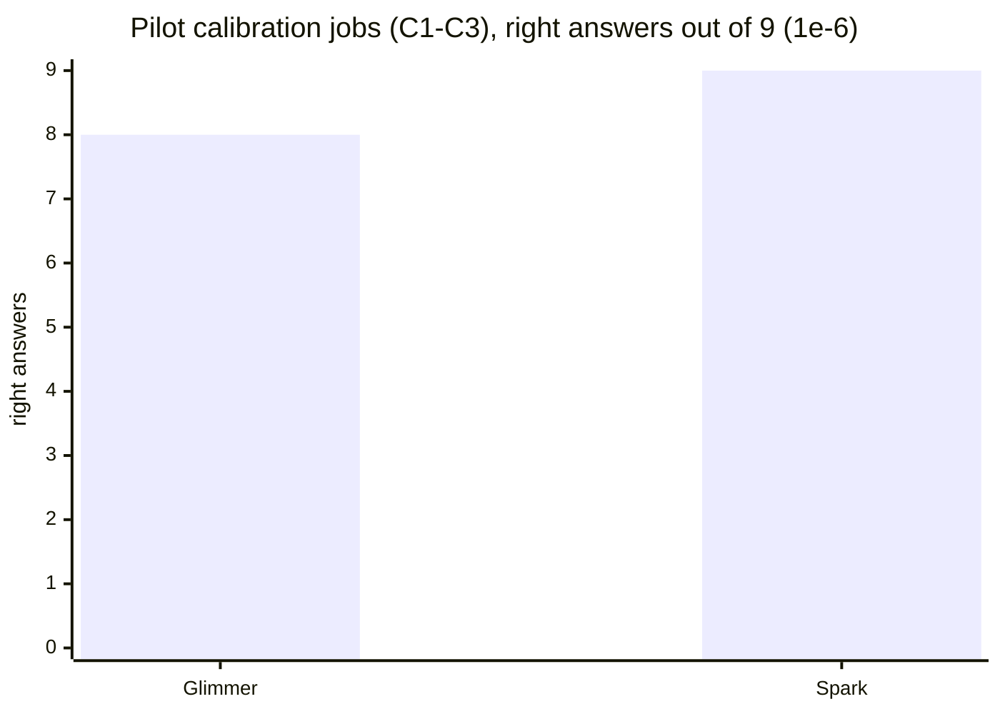

# Thinking exam pilot (FreeCAD + NDS-1, 40 rules): STOP, too easy for Glimmer

Run: results/thinking-2026-10-29-run2. Session 20:56-21:07 under caffeinate. Launch 1 was lost to Mac idle sleep;
see results/thinking-2026-10-29/LAUNCH_NOTE.md.

## Result (verified: pilot/calls.jsonl, pilot/summary.json)
- 30/30 answers graded; 0 harness errors, 0 INVALID.
- Calibration jobs C1-C3, 3 tries each, judged at 1e-6:

  | Model | Passes |
  |---|---|
  | Glimmer | 8/9 |
  | Spark | 9/9 |

- Glimmer's single miss was C2 (bearing plate) with a 0.2% mismatch. It would have passed the old 0.2% test.
- Warm-up jobs D1-D2: both models 6/6.
- **Pre-registered gate: Glimmer ≥ 8/9 → STOP, the exam is too easy.** The main run (13 jobs) was not started.

## Speed and cost per answer (main result, verified: pilot/summary.json)
| | Glimmer (Modal H100) | Spark Open (Baseten) |
|---|---|---|
| median time per answer | 167 s | 18 s |
| prompt tokens | 8,189 | 8,307 |
| output tokens | 4,267 | 3,438 |
| $ per answer | ≈ $0.023 pilot-only, ≈ $0.032 with deploy | $0.025 |

- Glimmer's $ is computed by hand: 11.4 GPU-minutes × $2.50/h = $0.48, over 15 answers, at 8 in parallel.
- Spark showed 0 cached tokens despite the affinity header, so every prompt was billed in full.
- **Glimmer is about 9× slower per answer, at about the same cost.** At this volume, the "many times cheaper and faster"
  case is not shown.

## What it means
- verified: Glimmer applies a 40-rule written standard almost perfectly, including picking which rules apply and
  checking thresholds. After FreeCAD dictation (93%), this is the second result where Glimmer matches the teacher.
- hypothesis: the remaining gap is not reasoning with rules in the prompt. It may be (a) knowing the company's
  standard WITHOUT the 8k-token prompt, which is what training adds; or (b) much longer, multi-part jobs.
- Money: launch 1 ≈ $0.60, run 2 ≈ $0.48 GPU + Spark $0.37. Forge ≈ $30.5 total.
